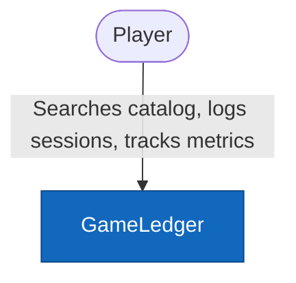
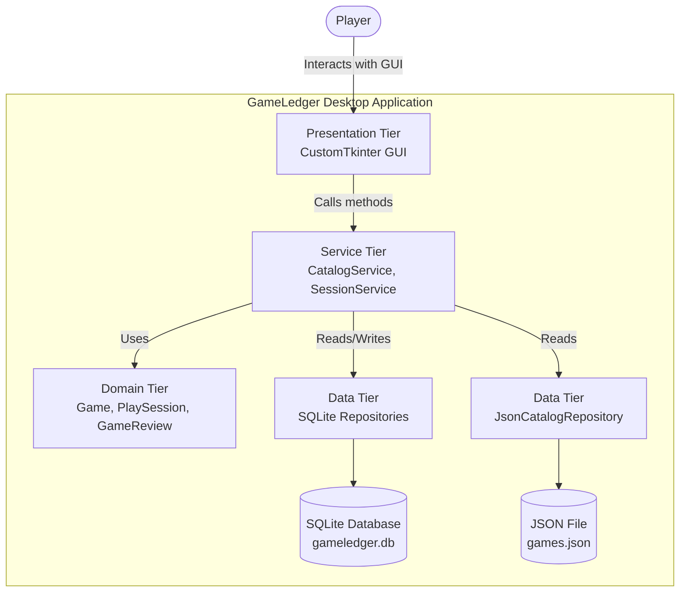
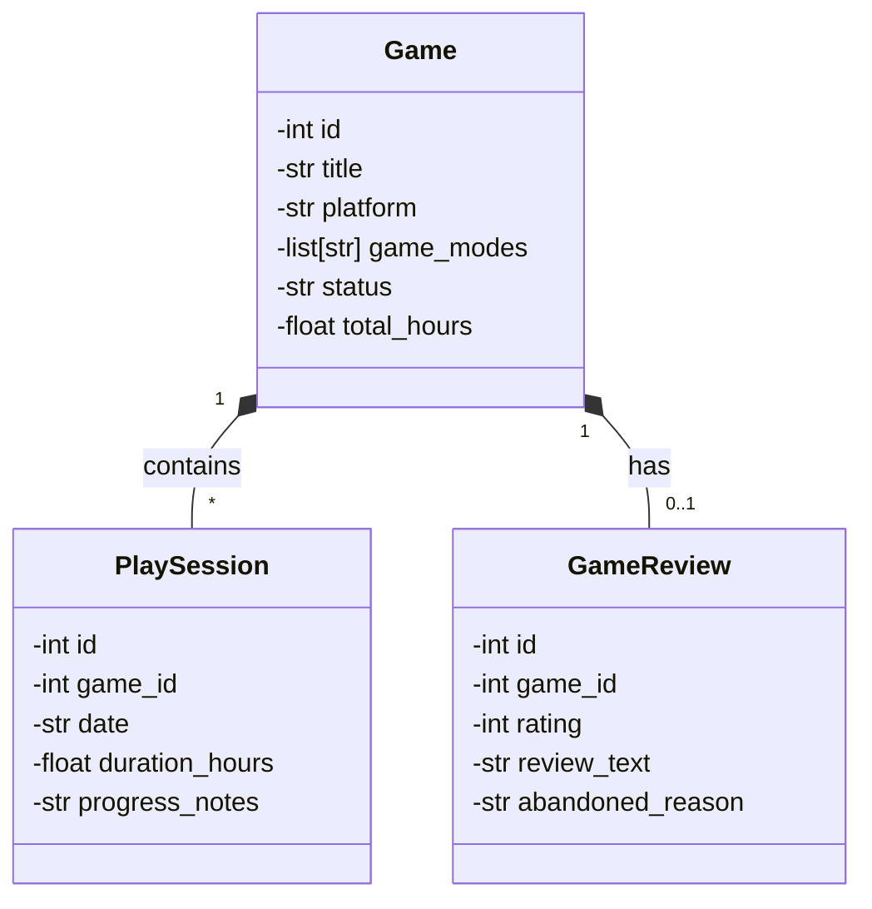
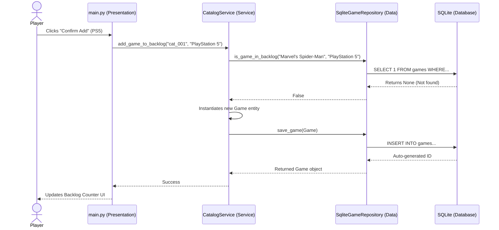

# GameLedger


**Student:** [David Liendo] · **Course:** CEN 5064 Software Design, Fall 2026 · **Partner:** [@kummarimonisha]

## Project

**GameLedger** is a personal, locally hosted, video game backlog and play-session management desktop system designed specifically for gamers who need a
centralized tool to track, organize, and manage their video game backlogs and play sessions. Unlike bloated web-based trackers, GameLedger focuses on
privacy, speed, and offline availability, storing all user data securely on their local machine via SQLite.

**Core Use Cases:**
1. **Search Local Catalog and Add Game to Backlog:** Users can dynamically search a local catalog of games (`games.json`) and persist specific platform versions to their personal library.
2. **Log a Play Session and Update Total Hours:** Users can record play dates, session durations, and personal progress notes, which automatically aggregate into the game's total playtime.
3. **Manage Game Lifecycle:** Users can transition a game's status (e.g., marking it as Completed or Abandoned) and leave optional ratings/reviews.
4. **View Aggregated Player Statistics:** Users can view a dashboard that generates completion statistics, tracks total time spent, and allows for global library filtering.

## How to run

Desktop GUI Application (Python 3.15, CustomTkinter). From a clean clone:

```bash
# 1. Create and activate a virtual environment
python -m venv .venv

# Activate on Windows:
.venv\Scripts\activate
# Activate on Mac/Linux:
source .venv/bin/activate

# 2. Install dependencies (CustomTkinter)
pip install -r requirements.txt

# 3. Start the application
python main.py
```

### Run the tests

```bash
python -m unittest tests/test_catalog_service.py
```

## Architecture

### Tier breakdown (Session 2 studio)

| Tier | Class | Responsibilities in THIS system |
| :--- | :--- | :--- |
| **Presentation** | `GameLedgerApp` | Renders the main CustomTkinter GUI, displaying the collapsible backlog and handling user navigation. |
| | `CatalogView` | Captures search inputs, applies category filters, and manages the platform selection dialog for adding games. |
| | `LogSessionForm` | UI component that collects date, duration, and notes for play sessions *(Upcoming)*. |
| **Service** | `CatalogService` | Orchestrates searching the local catalog and enforces the duplicate-prevention rule before adding to the backlog. |
| | `SessionService` | Validates session data and coordinates updating a game's total playtime and lifecycle status *(Upcoming)*. |
| **Domain** | `Game` | Represents the core game entity (title, platform, game modes, status, total hours) and guards its state. |
| | `PlaySession` | Represents an individual logged play session and its associated duration metrics. |
| | `GameReview` | Represents a completed game's user rating and review text, or an abandoned game's reasoning. |
| **Data** | `JsonCatalogRepository` | Reads, parses, and filters the static local `games.json` catalog file. |
| | `SqliteGameRepository` | Executes SQL queries to persist the user's backlog into the local `gameledger.db` SQLite database. |
| | `SqliteSessionRepository`| Manages saving and loading play sessions to and from the database *(Upcoming)*. |

### C4 — Context & Container (Session 3 studio)





### UML — Class & Sequence (Session 3 studio)





## Architecture Decision Records

| # | Decision | Status |
|---|----------|--------|
| [001](docs/adr/adr-001.md) | [Adopt a 4-Tier Python Architecture with SQLite and JSON for Local Data Storage] | [Accepted] |
| [002](docs/adr/adr-002.md) | [Building the Presentation Tier (GUI) using CustomTkinter] | [Accepted] |

## Weekly log (optional but recommended)

A one-line note per week keeps your commit story readable:

- Week 1 (Aug 24): repository created (cen5064-project-liendo), added full name and partner's GitHub username, added Project Title and detailed description of project (what it is, who it's for, and its 3-4 core features)
- Week 2 (Aug 31): added the complete 4-tier breakdown section, updated the section to include COMPLETED and ABANDONED checks while logging in a play session for a game, fixed the structure of the section to look more simpler and easier to read
- Week 3 (Sept 7): updated Weekly log section and logged all past weeks done
- Week 4 (Sept 14): updated "C4 - Context and Container" and "UML - Class and Sequence" sections by adding in diagrams
- Week 5 (Sept 21): Added Issue #1 in Issues board, created Branch for Issue #1, added Known Issues section to README.md, opened PR
- Week 6 (Sept 28):
- Week 7 (Oct 5): 
- Week 8 (Oct 12):

## Known Issues
- Issue #1: Log a play session and update game completion status
- Issue #3: Search local catalog and add game to backlog
