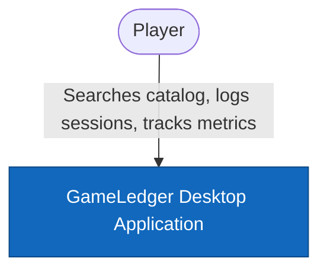
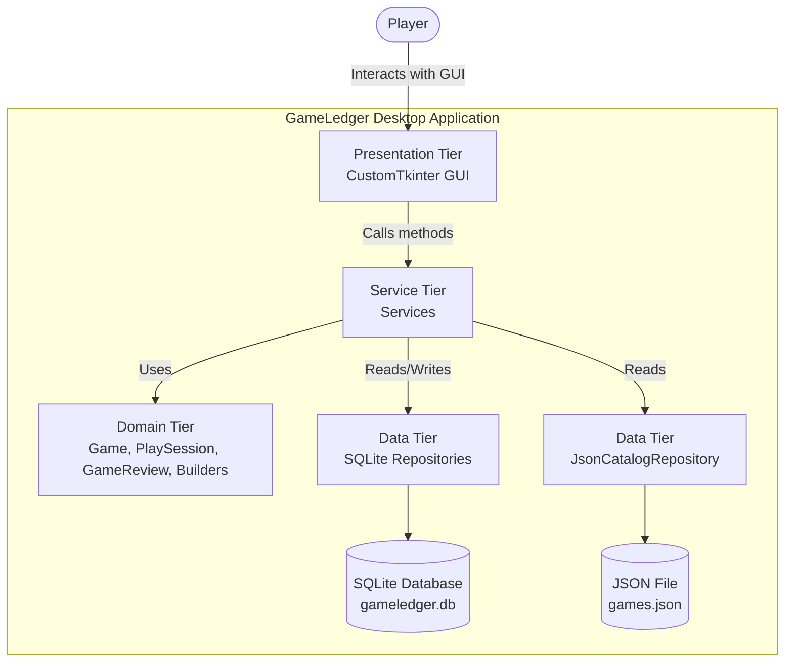
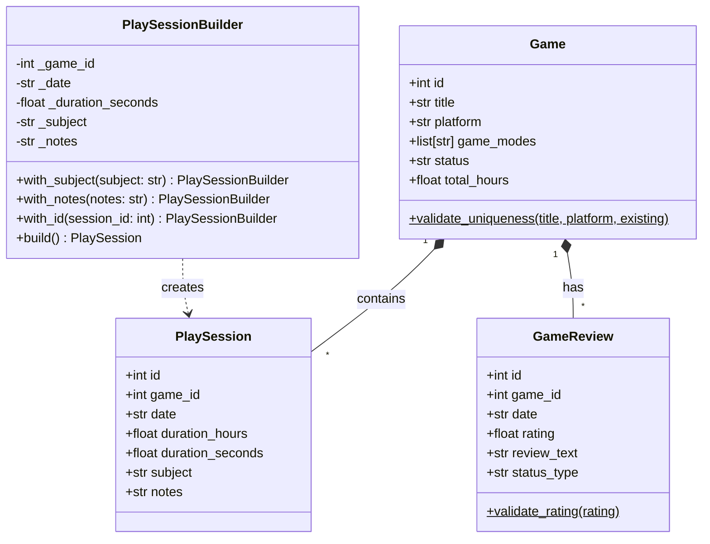
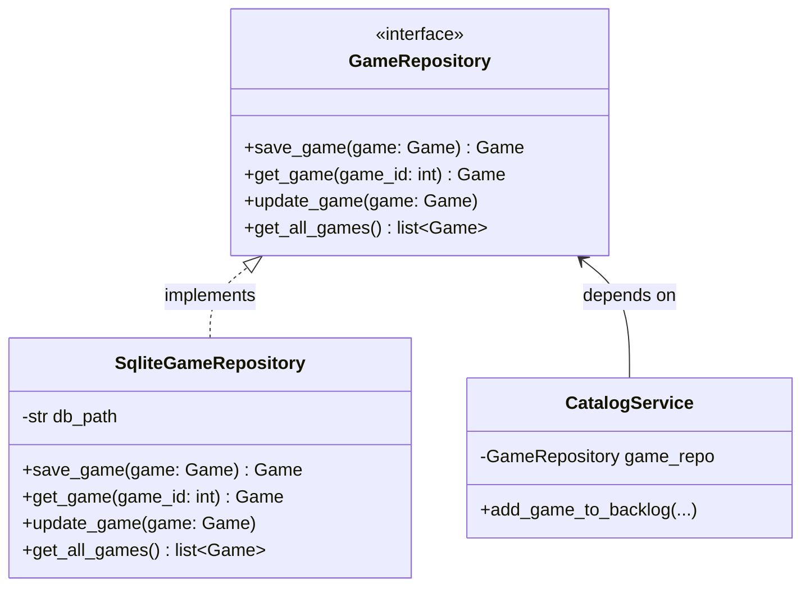
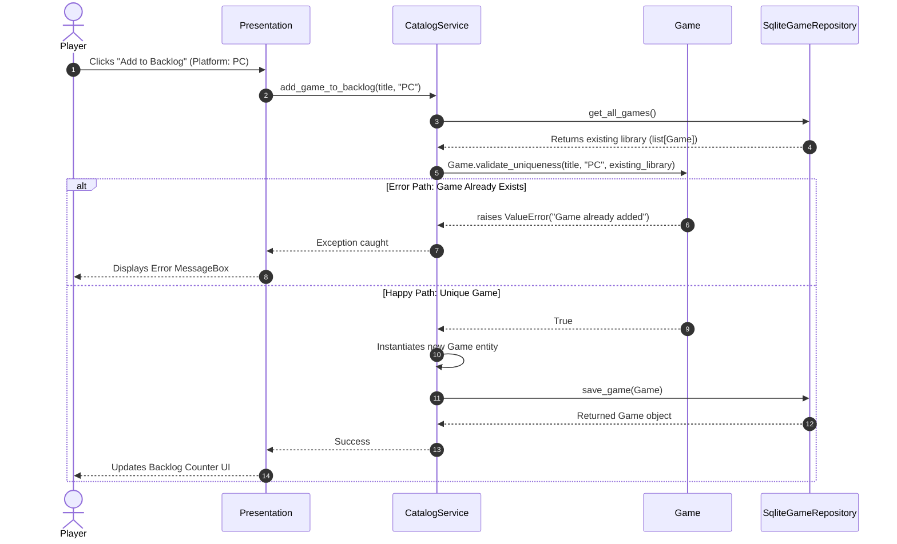
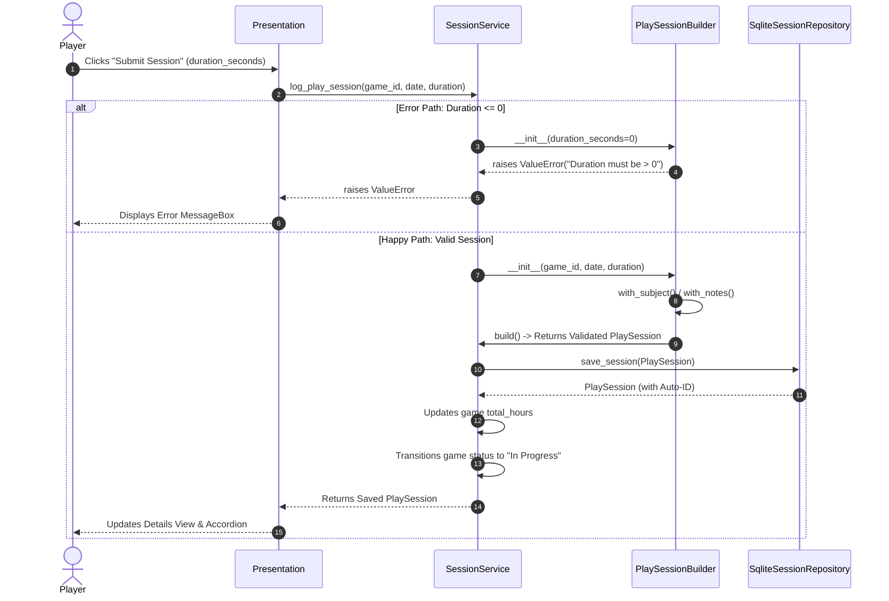
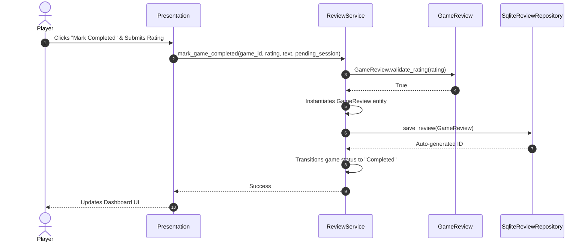
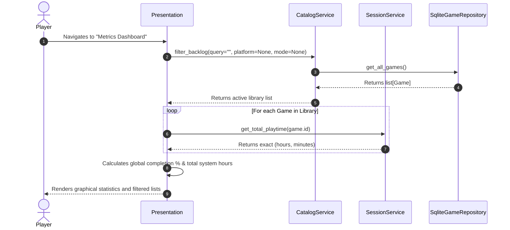
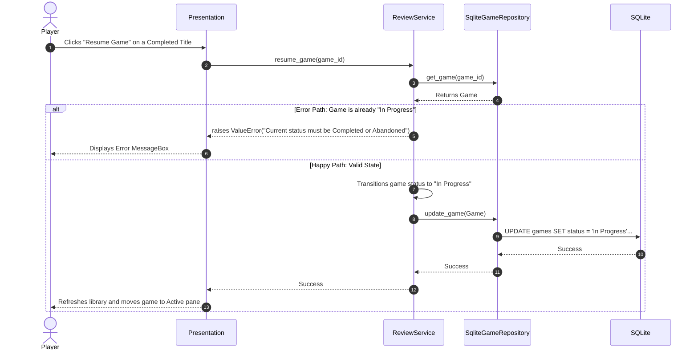

# GameLedger


**Student:** [David Liendo] · **Course:** CEN 5064 Software Design, Fall 2026 · **Partner:** [@kummarimonisha]

## Project

**GameLedger** is a personal, locally hosted, video game backlog and play-session management desktop application designed for gamers who need a
centralized tool to track their libraries and sessions.Unlike bloated web-based trackers, GameLedger focuses on privacy, speed, and offline
availability, storing all user data securely on the local machine via SQLite.

**Core Use Cases:**
1. **Search Local Catalog and Add Game:** Dynamically search a local catalog (`games.json`) and persist specific platform versions to the library. Duplicate additions are actively rejected by Domain-level invariant rules.
2. **Log a Play Session:** Record play dates, exact session durations using an anti-aliased real-time stopwatch, and progress notes. The system validates durations and automatically aggregates total playtimes.
3. **Manage Game Lifecycle & History:** Transition a game's status (e.g., Completed, Abandoned) and log multiple review histories over time. Archiving utilizes a soft-delete approach to prevent historical data loss.
4. **View Aggregated Player Statistics:** View dynamic layout panels that filter the library globally and aggregate completion statistics.

## How to run

Desktop GUI Application (Python 3.15, CustomTkinter, Pillow).

### Prerequisites (For First-Time Users)
* **Python 3.15+:** Download from python.org. **Important:** Check the box that says "Add Python to PATH" during installation.
* **Git:** Download from git-scm.com and ensure it is added to your system PATH.
* **Visual Studio Code:** Download from code.visualstudio.com and install the official **Python** extension.

### Setup and Execution
Open a new integrated terminal in VS Code (`Terminal > New Terminal`) and run the following commands:

```bash
# 1. Clone the repository and navigate into it
git clone <repository_url>
cd cen5064-project-liendo

# 2. Create a virtual environment
python -m venv .venv

# 3. Activate the virtual environment
# On Windows:
.venv\Scripts\activate
# On macOS/Linux:
source .venv/bin/activate

# 4. Install required packages
pip install -r requirements.txt

# 5. Start the application
python main.py
```

(Note: The `gameledger.db` and `ui_settings.json` files will auto-generate on the first run.)

### Run the tests

```bash
# Run pytest for business logic, Domain rules, and Builder verification
python -m pytest

# Run ruff for static analysis and linting
python -m ruff check .
```

## Architecture

### Tier breakdown (Session 2 studio)

| Tier | Class | Responsibilities in THIS system |
| :--- | :--- | :--- |
| **Presentation** | `GameLedgerApp (gui.py)` | Renders the CustomTkinter GUI, manages debounced window resizing, draws the real-time canvas stopwatch, and caches local cover images. Contains zero business logic. |
| **Service** | `CatalogService` | Orchestrates searching the local JSON catalog, retrieving metadata, and coordinating the addition of new platform-specific games to the backlog. |
|             | `SessionService` | Orchestrates `PlaySession` logging workflows, updates the game's total aggregated playtime, and handles automated game status transitions (e.g., from 'Backlog' to 'In Progress'). |
|             | `ReviewService` | Manages game lifecycles (Completed/Abandoned) and coordinates the deferred persistence flows when a user submits a rating and review text. |
| **Domain** | `Game` | A pure Python dataclass representing the core game entity. Holds state and enforces business rules like `validate_uniqueness()` to actively prevent duplicate backlog entries. |
|            | `PlaySession` | A pure Python dataclass representing a discrete block of playtime, containing the date, exact seconds, converted hours, and user notes. |
|            | `GameReview` | A pure Python dataclass representing a user's completion or abandonment milestone, enforcing validation invariants like `validate_rating()` (strictly 0.5 to 5.0 increments). |
|            | `PlaySessionBuilder` | Applies the Builder creational pattern to construct sessions step-by-step, explicitly enforcing the `duration > 0` constraint and automatically deriving hour conversions before instantiation. |
| **Data** | `JsonCatalogRepository` | Reads, parses, and filters the static local games.json catalog file for base game metadata. |
|          | `SqliteGameRepository` | Executes SQL queries to persist the user's active game library, total hours, and lifecycle statuses to `gameledger.db`. |
|          | `SqliteSessionRepository`| Executes SQL queries to save, update, and retrieve historical play sessions with sub-second precision. |
|          | `SqliteReviewRepository` | Executes SQL queries to persist and retrieve the historical review and rating timeline for games in the library. |
|          | `UiSettingsStore` | Enforces the Single Responsibility Principle (SRP) by extracting UI layout width persistence into local JSON configurations and providing corrupt-file recovery. |
|          | Abstract Interfaces | Defines the `CatalogRepository`, `GameRepository`, `SessionRepository`, and `ReviewRepository` contracts that the Service tier depends on, enforcing the Dependency Inversion Principle (DIP). | 

### C4 — Context & Container (Session 3 studio)

**Context Diagram**



<br>**Container Diagram**



### UML — Class & Sequence (Session 3 studio)

**Class Diagram 1: Domain Entities & Creational Patterns**
<br>_Showcases the core domain models, invariant validation methods (resolving midterm feedback to move rules to the Domain), and the_ `PlaySessionBuilder` _creational pattern._




<br>**Class Diagram 2: Data Tier Dependency Inversion (DIP)**
<br> _Demonstrates how the Service Tier relies on abstraction interfaces rather than concrete database implementations._



<br>**Sequence Diagram 1: Search Catalog & Add Game**
<br>_Highlights the Domain rule for preventing duplicate_ `(title, platform)` _library entries._



<br>**Sequence Diagram 2: Log a Play Session**
<br>_Highlights the Builder creational pattern enforcing duration > 0 limitations._



<br>**Sequence Diagram 3: Manage Game Lifecycle**
<br>_Highlights the deferred transactional persistence of a session leading directly into a status completion._



<br>**Sequence Diagram 4: View Aggregated Dashboard Metrics**
<br>_Demonstrates cross-service orchestration to calculate global completion percentages and total hours._



<br>**Sequence Diagram 5: Resume a Completed/Abandoned Game**
<br>_Highlights the Domain/Service error path preventing a user from resuming a game that is already active._




## Architecture Decision Records

| # | Decision | Status |
|---|----------|--------|
| [001](docs/adr/adr-001.md) | [Adopt a 4-Tier Python Architecture with SQLite and JSON for Local Data Storage] | [Accepted] |
| [002](docs/adr/adr-002.md) | [Building the Presentation Tier (GUI) using CustomTkinter] | [Accepted] |
| [003](docs/adr/adr-003.md) | [Hybrid Native tk.Canvas and Pillow Pipeline for Real-Time Stopwatch Feature] | [Accepted] |
| [004](docs/adr/adr-004.md) | [Soft-Delete Game Archiving and Multi-Review Event History in SQLite] | [Accepted] |
| [005](docs/adr/adr-005.md) | [Isolate UI Settings Persistence into UiSettingsStore (SRP)] | [Accepted] |
| [006](docs/adr/adr-006.md) | [Adopt Builder Pattern for PlaySessions and Reject Global Singletons] | [Accepted] |
| [007](docs/adr/adr-007.md) | [Scope Library Games by Platform and Drive Status via Lifecycle Events] | [Accepted] |
| [008](docs/adr/adr-008.md) | [Defer Session Persistence Across Multi-Step Completion and Abandonment Flows] | [Accepted] |

## Weekly log (optional but recommended)

A one-line note per week keeps your commit story readable:

- Week 1 (Aug 24): Repository created (cen5064-project-liendo), added full name and partner's GitHub username, added Project Title and detailed description of project (what it is, who it's for, and its 3-4 core features)
- Week 2 (Aug 31): Added the complete 4-tier breakdown section, updated the section to include COMPLETED and ABANDONED checks while logging in a play session for a game, fixed the structure of the section to look more simpler and easier to read
- Week 3 (Sept 7): Updated Weekly log section and logged all past weeks done
- Week 4 (Sept 14): Updated "C4 - Context and Container" and "UML - Class and Sequence" sections by adding in diagrams
- Week 5 (Sept 21): Shifted to professional GitHub workflow, added Issue #1 in Issues board, created Branch for Issue #1, added Known Issues section to README.md, opened PR
- Week 6 (Sept 28): Improved 4-tier architecture and local storage strategies.
- Week 7 (Oct 5): Locked in CustomTkinter for the presentation tier GUI.
- Week 8 (Oct 12): Refactored GUI strictly into Presentation tier, cleaned repository `.gitignore`, and filed first Midterm peer review for partner. (Midterm Check-In Action Items feedback)
- Week 9 (Oct 19): Resolved destructive `DROP TABLE` bug to ensure data survival; built real-time Stopwatch via `tk.Canvas`; filed second Midterm peer review for partner.
- Week 10 (Oct 26): Extracted UI settings to resolve SRP (Single Responsibility Principle) and scoped library games by platform to drive event-based statuses.
- Week 11 (Nov 2): Adopted Builder pattern for PlaySessions, implemented Soft-Delete archiving for multiple play sessions and mutii-review posts, and enforced deferred persistence for review flows.
- Week 12 (Nov 9): Overhauled text placeholders with local cover art via `CTkImage` asset caching; filed first Final peer review for partner.
- Week 13 (Nov 16): Addressed dynamic UI window resizing and debouncing rendering math (overcoming AI hallucination bottlenecks regarding Tkinter event loops); filed second Final peer review for partner (Final Check-In Action Items feedback)
- Week 14 (Nov 23): (Final Refactors) Finalized documentation, aligned codebase with UML/C4 diagrams, and relocated duplicate-prevention/boundary rules directly into the Domain tier based on midterm grading feedback.

## Known Issues
- Issue #1: Log a play session and update game completion status (COMPLETED)
- Issue #3: Search local catalog and add game to backlog (COMPLETED)
- Issue #4: View aggregated player statistics and filter library globally (COMPLETED)
- Issue #5: Mark game as completed and leave optional rating and/or review (COMPLETED)
- Issue #6: Mark game as abandoned and leave optional rating and/or review (COMPLETED)
- Issue #7: Resume a completed or abandoned game (COMPLETED)
